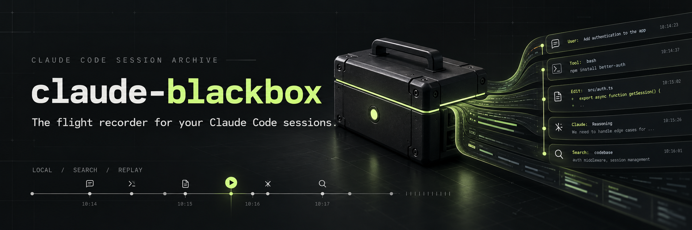

The flight recorder for your Claude Code sessions. Replay every conversation in a clean web UI

A local-first session archive built with **Bun**, **Solid 2 RC**, and **SQLite FTS5**. Search the full record, bring related workspaces together, and return to the exact moment that matters.

## Highlights

- **Full-record search** across prompts, responses, reasoning, file paths, commands, and tool inputs and results, with snippets that link straight to the matching event.
- **Filters and sorting** by workspace, folder, model, effort, Claude Code version, branch, date, tool, errors, bookmarks, cost, tokens, and active time.
- **Structured replay** of Markdown, diffs, terminal output, tool calls with their results, reasoning, and errors, with every raw record one click away.
- **Workspace groups** that give worktrees and clones one shared history without moving files.
- **Usage and estimated cost** per recording, folder, workspace group, and model/effort pair, beside Claude Code's own recorded total.
- **Subagent navigation** between a main session and the agents it launched.
- **Live updates** as recordings grow, without pulling you away from what you are reading.

## Quick Start

Requires **Bun 1.4+** and a current browser.

```sh
bun install
bun run build
bun start
```

Open `http://127.0.0.1:12001`. The server reads `~/.claude/projects` by default, or the Claude directory specified by `CLAUDE_CONFIG_DIR`. Nothing needs to be imported, and `history.jsonl` is not required.

```sh
bun start --dir /path/to/.claude --port 12001
bun start --dir /path/to/.claude --state-dir /path/to/private-blackbox-index
bun start --help
```

On Windows, quote paths with spaces. To use a `claude-blackbox` command, run `bun link` after building; Bun must remain installed, since this is a Bun-native application, not a Node server.

### Desktop App (Optional)

A Tauri 2 wrapper runs the same local server in a native window, with a system tray and signed updates. With the Tauri prerequisites installed, `bun run desktop` launches a development build and `bun run desktop:build` produces installers. See [Desktop app](docs/desktop.md).

### Demo

```sh
bun run build
bun run demo
```

Open `http://127.0.0.1:12002`. The demo creates 17 explicitly synthetic sessions, including a two-day session long enough to show the replay activity strip and a session that launches three agents, in `.blackbox/demo` and a separate index in `.blackbox/demo-state`. It never reads or modifies your Claude data. The generator only overwrites its own marked fixture files.

## Search

Words combine with AND, even across different events of the same session. Quote phrases and prefix exclusions with a minus sign:

```text
authentication retry
"default limit" -timeout
src/auth.ts
```

Press `Ctrl/⌘ K` or `/` to search and `?` for every shortcut. The [library guide](docs/library.md) covers search, filters, and sorting in full.

## Privacy And Storage

- Binds to **loopback only**. Foreign origins, unsafe mutation requests, and non-loopback hostnames are rejected. There is no permissive CORS mode, account, telemetry, or cloud service.
- Source transcripts are **read-only**. Workspace groups and bookmarks are stored only in the application index. Logged commands are never executed.
- Markdown is sanitized. Scripts, arbitrary styling, and remote images are blocked. Supported embedded bitmap attachments require an explicit reveal action.
- The derived SQLite index contains searchable transcript content and raw records. **It is sensitive, unencrypted local data**, not a redacted or encrypted vault. Protect it with the same care as your Claude directory. Windows permissions follow the parent directory's ACL; newly created Unix state directories request mode `0700`.
- Default state: `~/.cache/claude-blackbox/<source-directory-hash>/index.sqlite`. A custom state directory must be outside the Claude data directory, including through directory links.
- To reset, stop the server and remove only its chosen state directory. The next start rebuilds the index. This also removes its bookmarks and workspace groups; your source recordings remain untouched.

## Documentation

| Guide | Covers |
| --- | --- |
| [Library](docs/library.md) | Search syntax, session titles, filters, sorting, workspace groups, subagent visibility, indexing status |
| [Replay](docs/replay.md) | Views, find, replay filters, activity strip, errors, Claude Code's own records, session families, live updates |
| [Usage and cost](docs/usage-and-cost.md) | Token totals, how API-equivalent cost is estimated, and where the estimate stops |
| [Layout and keyboard](docs/layout-and-keyboard.md) | Themes, reading width, responsive layouts, keyboard shortcuts |
| [Desktop app](docs/desktop.md) | Building, system tray, updates, the Windows local preview launcher |
| [Development](docs/development.md) | Dev servers with isolated state, browser tests, recording format inspection |
| [Releases](docs/releases.md) | The release command, desktop release workflow, updater signing |
| [Architecture](docs/architecture.md) | Module boundaries, data flow, live updates, responsive workspace |
| [SQLite index schema](docs/sqlite-schema.md) | Tables, columns, and schema versions of the derived index |
| [Commands run overview](docs/command-overview.md) | How the replay groups and previews shell commands |

## Development

```sh
bun run dev --state-dir .blackbox/dev-state
bun run check
bun run test:e2e
```

Development uses Vite on `127.0.0.1:12000` and the Bun API on `127.0.0.1:12001`. Always give development and review servers their own `--state-dir`; changing the port does not isolate the index from the installed app's. Coding agents must read `AGENTS.md` and `CLAUDE.md` before starting local servers or desktop previews. See [Development](docs/development.md) and [Releases](docs/releases.md).
