# SQLite index schema

claude-blackbox keeps one SQLite database, `index.sqlite`, in its state directory. It is the derived index of the Claude Code recordings the server reads, plus the user's bookmarks and workspace groups. Everything below is derived from `src/server/recorder.ts`, which owns the schema, the migrations, and every query, together with the normalization and usage helpers it calls.

## Overview

`src/server/cli.ts` chooses the state directory: `--state-dir` when given, otherwise `~/.cache/claude-blackbox/<source-directory-hash>/`, where the hash is the first 12 hexadecimal characters of the SHA-256 of the absolute Claude data directory path (`--dir`, else `CLAUDE_CONFIG_DIR`, else `~/.claude`) as given, before directory links are resolved. `Recorder.open()` resolves both the data directory and the state directory through existing directory links, refuses a state directory that is the data directory or lies inside it (compared case-insensitively on Windows), creates the state directory with mode `0700`, and opens `index.sqlite` with `create: true`.

The index is derived data. Every row in `sessions`, `events`, `usage_records`, `session_costs`, `tool_results`, `tool_calls`, `session_facets`, and `event_fts` is rebuilt from the JSONL recordings under `<data directory>/projects`, which the server only reads. The three user-owned tables, `bookmarks`, `groups`, and `group_paths`, exist nowhere else; deleting the state directory loses them, as the README says.

The index holds sensitive, unencrypted transcript content. `events.raw` stores every recorded record verbatim, `events.text` stores its searchable flattening, and `tool_results.raw` stores recorded tool output. Protect the state directory like the Claude directory itself.

On every open, the constructor runs the `schema` script, which begins with three pragmas:

| Pragma | Scope | Effect |
| --- | --- | --- |
| `journal_mode = WAL` | Persistent in the database file | Readers and the writer do not block each other, so a separate read-only connection can inspect the index while the server writes to it. |
| `busy_timeout = 5000` | This connection | A locked database waits up to five seconds instead of failing. |
| `foreign_keys = ON` | This connection | `ON DELETE CASCADE` on the derived tables runs; a connection that does not set this pragma (for example a read-only inspection connection) does not inherit it. |

The code sets no other pragma; `synchronous`, `page_size`, and the rest keep SQLite's defaults. Because of WAL mode, `index.sqlite-wal` and `index.sqlite-shm` sit beside `index.sqlite` while a connection is open. A clean close checkpoints and removes them; after a forced exit they can remain and hold committed data, so a backup of the state directory must include all three files.

The schema version lives in `PRAGMA user_version` and is currently 16 (see [Schema versions](#schema-versions)).

## Derived and user-owned data

| Table | Kind | Filled by | Removed by |
| --- | --- | --- | --- |
| `sessions` | Derived | `reconcile()`, one row per recording file | `reconcile()` when the file is gone from a complete scan |
| `events` | Derived | `reconcile()`, one row per complete JSONL record | A re-index of its recording, or the cascade from `sessions` |
| `usage_records` | Derived | `reconcile()` from `readUsage()` in `src/server/usage.ts` | A re-index, or the cascade from `sessions` |
| `session_costs` | Derived | `reconcile()` from `readCostState()` in `src/server/usage.ts`, at most one row per recording | A re-index, or the cascade from `sessions` |
| `tool_results` | Derived | `reconcile()` from `tool_result` blocks | The cascade from `events` or `sessions` |
| `tool_calls` | Derived | `reconcile()` from `tool_use` blocks | The cascade from `events` or `sessions` |
| `session_facets` | Derived | `reconcile()` | A re-index, or the cascade from `sessions` |
| `event_fts` | Derived | The `event_insert` trigger | The `event_delete` trigger |
| `bookmarks` | User-owned | `bookmark()` behind `PUT /api/sessions/:id/bookmark` | `bookmark()` with `false` |
| `groups` | User-owned | `saveGroup()` behind `POST /api/groups` | `deleteGroup()` behind `DELETE /api/groups/:id` |
| `group_paths` | User-owned | `saveGroup()` | `saveGroup()` rewriting a group, or the cascade from `groups` |

Resets and migrations preserve the user-owned tables by construction. No migration drops a table or deletes rows; every reset is the single statement `UPDATE sessions SET mtime=0, identity=''`, which only marks recordings for re-reading. When the next scan re-reads a marked recording, it deletes that recording's `events`, `usage_records`, `session_costs`, and `session_facets` rows (the `tool_results` and `tool_calls` rows go with their events through `ON DELETE CASCADE`) and zeroes the counters on the `sessions` row, but the `sessions` row itself and its `id` stay. The id is deterministic, the first 24 hexadecimal characters of the SHA-256 of the path relative to the data directory that the recording had when it was first indexed, so a `bookmarks` row keeps matching its recording across any number of re-indexes, and so does a `group_paths` row, which is keyed by the working directory rather than by a recording at all. A recording that Claude Code moves to another project folder keeps its row too (see [Incremental indexing](#incremental-indexing)), so its id then no longer equals the hash of its current path.

Neither `bookmarks.session_id` nor `group_paths.path` declares a foreign key to `sessions`. A bookmark of a recording whose file disappears stays in the table as an orphan that no query returns (the catalog counts bookmarks through a join on `sessions`), and matches again if a recording with the same relative path returns. `saveGroup()` checks each path against `sessions.cwd` only at save time.

## Entity relationships

Solid lines are declared foreign keys, all with `ON DELETE CASCADE`. Dotted lines are relationships without a foreign key: `event_fts` follows `events` through its triggers, a call and its result share `(session_id, tool_id)`, a group path matches `sessions.cwd`, and a bookmark matches `sessions.id`.

```mermaid
erDiagram
  sessions ||--o{ events : "session_id"
  sessions ||--o{ usage_records : "session_id"
  sessions ||--o| session_costs : "session_id"
  sessions ||--o{ session_facets : "session_id"
  sessions ||--o{ tool_calls : "session_id"
  sessions ||--o{ tool_results : "session_id"
  events ||--o{ tool_calls : "event_row"
  events ||--o{ tool_results : "event_row"
  events ||..|| event_fts : "rowid, by triggers"
  tool_calls |o..o| tool_results : "session_id, tool_id"
  groups ||--o{ group_paths : "group_id"
  group_paths |o..o{ sessions : "path = cwd"
  sessions |o..o| bookmarks : "id = session_id"

  sessions {
    TEXT id PK "sha256 of first relative path, 24 hex"
    TEXT session_id
    TEXT source UK "absolute recording path"
    TEXT cwd
    TEXT title
    TEXT branch
    TEXT model
    TEXT started
    TEXT updated
    INTEGER events
    INTEGER messages
    INTEGER tools
    INTEGER errors
    INTEGER edits
    INTEGER agent
    INTEGER size
    REAL mtime "0 marks for re-read"
    INTEGER cursor
    TEXT fingerprint "prefix checkpoint"
    INTEGER warnings
    INTEGER named
    TEXT identity "device:inode"
    TEXT tailprint "tail checkpoint"
    INTEGER turns "turn_duration records"
    INTEGER active_ms "sum of their durationMs"
    TEXT version "last Claude Code version named"
    INTEGER unrecognized "records of unknown kinds"
  }
  events {
    INTEGER rowid PK "reused after a re-index"
    TEXT event_id UK "sessions.id-offset, stable"
    TEXT session_id FK
    INTEGER sequence
    INTEGER offset
    TEXT category
    TEXT type
    INTEGER error
    TEXT tools
    TEXT raw "whole record"
    TEXT text "searchable text"
    TEXT role
    TEXT timestamp
    TEXT model
    TEXT cwd
    INTEGER has_thinking
    INTEGER has_tools
    INTEGER decision
  }
  event_fts {
    INTEGER rowid "events.rowid"
    TEXT text "FTS5 external content"
  }
  usage_records {
    TEXT session_id PK, FK
    TEXT request_key PK
    INTEGER input
    INTEGER output
    INTEGER cache_creation
    INTEGER cache_read
    REAL cost
    INTEGER recorded
    INTEGER sidechain
    TEXT model
    TEXT effort
    TEXT rates
    INTEGER unrated
  }
  session_costs {
    TEXT session_id PK, FK
    REAL cost "Claude Code's totalCostUSD"
    TEXT started
    INTEGER unknown_models
    TEXT model_usage "JSON by normalized model"
    REAL api_ms "totalAPIDuration or NULL"
    REAL tool_ms "totalToolDuration or NULL"
  }
  tool_calls {
    TEXT session_id PK, FK
    TEXT tool_id PK
    TEXT name
    INTEGER event_row FK
  }
  tool_results {
    TEXT session_id PK, FK
    TEXT tool_id PK
    TEXT raw "the tool_result block"
    INTEGER event_row FK
  }
  session_facets {
    TEXT session_id PK, FK
    TEXT kind PK "model, cwd, tool, version, or unrecognized"
    TEXT value PK
  }
  bookmarks {
    TEXT session_id PK "no foreign key"
  }
  groups {
    TEXT id PK
    TEXT name
  }
  group_paths {
    TEXT path PK "matches sessions.cwd"
    TEXT group_id FK
  }
```



## Tables

Types, constraints, and defaults below are exactly those in the `CREATE TABLE` statements and the `ALTER TABLE` migrations. A `Since` note marks a column that a later version added through `ALTER TABLE`; the current `CREATE TABLE` statements already include it for new indexes.

### sessions

One row per recording file. `reconcile()` inserts the row with `id`, `session_id`, `source`, and `agent` as soon as it sees a new file, then overwrites the remaining columns after reading the file to its end. The counters are accumulated while reading, so a row whose `events` differs from the number of its `events` rows marks an interrupted import.

| Column | Type and constraints | Meaning and source |
| --- | --- | --- |
| `id` | `TEXT PRIMARY KEY` | First 24 hexadecimal characters of the SHA-256 of the path relative to the data directory at insert time. A recording that Claude Code moved to another project folder keeps the id of its first path. The `/api/sessions/:id` routes accept exactly `[a-f0-9]{24}`. |
| `session_id` | `TEXT NOT NULL` | The file name without `.jsonl` at insert time, then replaced by each record's `sessionId` or `session_id` field, so the last record that names one wins. |
| `source` | `TEXT NOT NULL UNIQUE` | Absolute path of the recording, rewritten when the scan finds the recording moved to another project folder. The scan keys its known recordings by this column, and the family queries match subagent recordings by prefixes of it. |
| `cwd` | `TEXT NOT NULL DEFAULT ''` | The first non-empty `cwd` field of any record. |
| `title` | `TEXT NOT NULL DEFAULT ''` | A record's `customTitle` or `aiTitle`, or the `title` of an `ai-title` or `custom-title` record, cut to 240 characters; otherwise `promptTitle()` of the first user record (role `user`) it titles, cut to 180 characters; otherwise `Session ` plus the first eight characters of `session_id`. `promptTitle()` follows Claude Code's own first-prompt rules on the record's text blocks, with terminal escape sequences stripped and trimmed: a record that starts with `<local-command-stdout>`, `<local-command-caveat>`, `<session-start-hook>`, or `[Request interrupted by user` gives no title; a record that starts with `<command-name>` titles as the command name, a space, and the `<command-args>` text, collapsed to single spaces, or gives no title when that text is missing or blank; a record that starts with `<bash-input>` titles as `! ` and the command, or gives no title when the command is blank; any other record titles as its text with `<system-reminder>`, `<ide_opened_file>`, and `<ide_selection>` blocks removed and then every remaining tag removed, so a record that holds only IDE context gives no title. An explicit title always wins. A prompt sets the title only while it is empty or, with no explicit title recorded, still starts with `Session `, which is how a fallback left by an earlier read, or by records the rules skip, gets replaced. |
| `branch` | `TEXT NOT NULL DEFAULT ''` | The last non-empty `gitBranch` field. |
| `model` | `TEXT NOT NULL DEFAULT ''` | The last `message.model` that is not `<synthetic>`, stored as recorded, not normalized. |
| `started` | `TEXT NOT NULL DEFAULT ''` | Smallest record timestamp as an ISO string; the file's modification time when no record has one. |
| `updated` | `TEXT NOT NULL DEFAULT ''` | Largest record timestamp as an ISO string; the file's modification time when no record has one. |
| `events` | `INTEGER NOT NULL DEFAULT 0` | Number of complete, parseable records read. |
| `messages` | `INTEGER NOT NULL DEFAULT 0` | Records whose category is `message`. |
| `tools` | `INTEGER NOT NULL DEFAULT 0` | Total `tool_use` blocks across all records. |
| `errors` | `INTEGER NOT NULL DEFAULT 0` | Records whose `error` flag is set: failures, not the decisions `events.decision` marks. |
| `edits` | `INTEGER NOT NULL DEFAULT 0` | 1 when any tool name matches `edit`, `write`, `multiedit`, or `notebookedit` case-insensitively. |
| `agent` | `INTEGER NOT NULL DEFAULT 0` | 1 when the path contains a `subagents` directory segment or the file name starts with `agent-`. |
| `size` | `INTEGER NOT NULL DEFAULT 0` | File size in bytes at the last read. |
| `mtime` | `REAL NOT NULL DEFAULT 0` | File modification time in milliseconds at the last read. 0 marks the recording for re-reading. |
| `cursor` | `INTEGER NOT NULL DEFAULT 0` | Byte offset at which the next read starts: the end of the last complete record. |
| `fingerprint` | `TEXT NOT NULL DEFAULT ''` | SHA-256 of the first `min(size, 256)` bytes, the prefix checkpoint. |
| `warnings` | `INTEGER NOT NULL DEFAULT 0` | Complete lines that did not parse as a JSON object. |
| `named` | `INTEGER NOT NULL DEFAULT 0` | 1 when `title` came from an explicit title field. |
| `identity` | `TEXT NOT NULL DEFAULT ''` | `<device>:<inode>` from `stat()`, rewritten with `source` when the recording is found moved, unless it is empty. An empty string marks the recording for re-reading. Since version 2. |
| `tailprint` | `TEXT NOT NULL DEFAULT ''` | SHA-256 of the last `min(size, 256)` bytes, the tail checkpoint. Since version 2. |
| `turns` | `INTEGER NOT NULL DEFAULT 0` | Records of type `system` and subtype `turn_duration`, which Claude Code 2.1.27x and later write at the end of each turn. 0 means the recording holds none, and the session's `activeTime` is then null rather than 0. Since version 14. |
| `active_ms` | `INTEGER NOT NULL DEFAULT 0` | Sum of those records' `durationMs`, the recording's active time, from `turnDuration()` in `src/shared/records.ts`: a `durationMs` that is not a safe integer from 0 to 10^15 adds 0, as Claude Code's own loader rewrites it. Accumulated like the counters above. Since version 14. |
| `version` | `TEXT NOT NULL DEFAULT ''` | The last record `version` that `recordedVersion()` in `src/shared/records.ts` accepts: a string in the shape of a semantic version, with major, minor, and patch numbers of at most 4, 5, and 6 digits and an optional prerelease and build of at most 32 letters, digits, `.`, or `-` each. Claude Code names the version that wrote a record on its `user`, `assistant`, `system`, and `attachment` records and its API request records, and a resumed or forked copy keeps its original's version, so this is the version behind the latest such record. Empty when no record names one. Since version 16. |
| `unrecognized` | `INTEGER NOT NULL DEFAULT 0` | Records this build does not recognize, as `unrecognizedKind()` in `src/shared/records.ts` decides: a record whose type (as stored in `events.type`) is not in `recordPolicy`, or a `system` record whose `subtype`, or an `attachment` record whose `attachment.type`, is present, not null, and not a string in `systemSubtypes` or `attachmentTypes`. Accumulated like the counters above. Since version 16. |

Indexes: `sessions_cwd` on `(cwd)` serves the `group_paths` join, the workspace and `cwd` filters, the catalog's grouping by folder, and `saveGroup()`'s check that each path is a known working directory. `sessions_updated` on `(updated DESC)` serves the default `recent` ordering and the `days`, `after`, `before`, and `active` filters. The `UNIQUE` constraint on `source` keeps one row per recording file; the scan itself loads every row and matches files by `source` in memory.

### events

One row per complete JSONL record, in file order. `reconcile()` calls `normalize()` in `src/server/normalize.ts` on each record and inserts the result with `INSERT OR IGNORE`, so a record that is already present under its `event_id` is skipped.

| Column | Type and constraints | Meaning and source |
| --- | --- | --- |
| `rowid` | `INTEGER PRIMARY KEY` | SQLite's row number, without `AUTOINCREMENT`. Referenced by `tool_results.event_row`, `tool_calls.event_row`, and `event_fts`. See [Row identity](#row-identity). |
| `event_id` | `TEXT NOT NULL UNIQUE` | `<sessions.id>-<offset>`, built in `normalize()`. The stable identifier the client and the `anchor` parameter use. |
| `session_id` | `TEXT NOT NULL REFERENCES sessions(id) ON DELETE CASCADE` | The recording's `sessions.id`. |
| `sequence` | `INTEGER NOT NULL` | Zero-based position of the record in its recording. Every page, position, and timeline query orders by it. |
| `offset` | `INTEGER NOT NULL` | Byte offset of the record's line in the file. |
| `category` | `TEXT NOT NULL` | `system` when the role is system; `synthetic` when an `assistant` record is Claude Code's own stand-in for a model turn, that is, its `message.model` is `<synthetic>` or it has `isApiErrorMessage: true`; `hidden` when every block is reasoning the API did not return; `message` when a text block has content; `tool` when a `tool_use` or `tool_result` block is present; otherwise `thinking`. |
| `type` | `TEXT NOT NULL` | The record's `type` field, or `unknown`. |
| `error` | `INTEGER NOT NULL` | 1 when a block has `is_error: true` without recording a decision (see `decision`), the record has `is_error: true` or `isApiErrorMessage: true`, or its `level` is `error`. Since version 12 for the decision rule. |
| `tools` | `TEXT NOT NULL` | Names of the record's `tool_use` blocks (`Unknown tool` for a missing name) that pass `isFacetValue()`, joined by newlines. The tool filters test this column with `instr()`. |
| `raw` | `TEXT NOT NULL` | `JSON.stringify` of the whole record. Replay, export, and the summary parse it back. |
| `text` | `TEXT NOT NULL` | The searchable text (see [Full-text search](#full-text-search)). |
| `role` | `TEXT NOT NULL DEFAULT ''` | `user` or `assistant` when the type is one of those and the record is neither `isMeta` nor `isCompactSummary`; otherwise `system`. Since version 5. |
| `timestamp` | `TEXT NOT NULL DEFAULT ''` | The record's `timestamp` as an ISO string, or empty when missing or unparseable. Since version 5. |
| `model` | `TEXT NOT NULL DEFAULT ''` | `message.model` as recorded, including `<synthetic>`, not normalized. Since version 5. |
| `cwd` | `TEXT NOT NULL DEFAULT ''` | The record's `cwd` field, or for a `relocated` record, which has none, its `relocatedCwd`: the working directory Claude Code moved the session to (version 15). Since version 5. |
| `has_thinking` | `INTEGER NOT NULL DEFAULT 0` | 1 when a `thinking` block has non-empty `thinking` or `text`. Since version 5. |
| `has_tools` | `INTEGER NOT NULL DEFAULT 0` | 1 when a `tool_use` or `tool_result` block is present. Since version 5. |
| `decision` | `INTEGER NOT NULL DEFAULT 0` | 1 when a `tool_result` block with `is_error: true` records a decision rather than a failure: Claude Code's own message for a permission that the user, a permission rule, or a non-interactive mode refused, for a PreToolUse hook that stopped the call, or for an interruption, as `resultDecision()` in `src/shared/decisions.ts` matches it. The `errors=1` replay filter selects these records with the errors; nothing counts them as errors. Since version 12. |

Indexes: `events_session` on `(session_id, sequence)` serves every per-recording query: paging and anchors in `events()`, `matches()`, `timeline()`, `summary()`, the export route, and the interrupted-import check. `events_model`, `events_timestamp`, `events_cwd`, and `events_tools`, each on `(session_id, <column>)`, serve the replay filters of the same name and the model and tool filters of the library listing, which test a session's events with `EXISTS`; `events_cwd` also serves the summary's first record per working directory. These four are created in the constructor rather than in the `schema` script because their columns were added by `ALTER TABLE` in version 5. `decision` has no index: the filter that reads it always runs within one recording through `events_session`. The `UNIQUE` constraint on `event_id` serves the `anchor` lookup and makes `INSERT OR IGNORE` idempotent.

### usage_records

One row per API request. `readUsage()` in `src/server/usage.ts` returns a record for an `assistant` record whose `message.model` is not `<synthetic>` and that carries at least one non-negative token count or a `costUSD`.

| Column | Type and constraints | Meaning and source |
| --- | --- | --- |
| `session_id` | `TEXT NOT NULL REFERENCES sessions(id) ON DELETE CASCADE` | The recording's `sessions.id`. |
| `request_key` | `TEXT NOT NULL` | A JSON array string: `["message", <message.id>, <requestId or request_id, else sessionId, else the session id>]` when the message has an id, otherwise `["event", <sessionId or session id>, <uuid or event_id>]`. The same key can appear in several recordings, and the library totals count each key once. |
| `input` | `INTEGER NOT NULL` | `usage.input_tokens`. |
| `output` | `INTEGER NOT NULL` | `usage.output_tokens`. |
| `cache_creation` | `INTEGER NOT NULL` | The larger of `usage.cache_creation_input_tokens` and `cache_creation.ephemeral_5m_input_tokens + cache_creation.ephemeral_1h_input_tokens`. |
| `cache_read` | `INTEGER NOT NULL` | `usage.cache_read_input_tokens`. |
| `cost` | `REAL` | The record's `costUSD` when present; otherwise the cost computed from the bundled rates; `NULL` when neither applies. |
| `recorded` | `INTEGER NOT NULL` | 1 when `cost` came from `costUSD`. |
| `sidechain` | `INTEGER NOT NULL` | 1 when the record has `isSidechain: true`. |
| `model` | `TEXT NOT NULL DEFAULT ''` | `normalizeModel(message.model)`, the bundled rate table's key. Since version 4. |
| `effort` | `TEXT` | The first value among `message.effort`, `effort`, `message.output_config.effort`, and `output_config.effort` that, trimmed and lowercased, passes `isFacetValue()` with an 80-character limit; `NULL` when none. Since version 4. |
| `rates` | `TEXT NOT NULL DEFAULT ''` | `rateStamp(model)`: 16 hexadecimal characters identifying the rate entry and formula revision the row was priced with. Added without a version bump, see [Schema versions](#schema-versions). |
| `unrated` | `INTEGER NOT NULL DEFAULT 0` | 1 when `cost` is `NULL`, the model is named, and the rate table has no entry for it. Added with `rates`. |

The primary key is `(session_id, request_key)`. The insert is an upsert: a conflicting row is replaced only when the new row has a lower `sidechain`, or the same `sidechain` and more total tokens, or the same tokens and a recorded cost over a computed one, or the same again and a higher cost. `model`, `rates`, and `unrated` keep their stored values when the new row has an empty model, and `effort` is taken from whichever row has one. A second statement fills `effort` on an existing row that lacked it.

Indexes: `usage_efforts` on `(effort)` serves the catalog's distinct effort list and the `effort` and `effortMissing` filters.

### session_costs

At most one row per recording: Claude Code's own running total for the session, from the last `cost-state` record in the file. `readCostState()` in `src/server/usage.ts` returns a total for a record whose `type` is `cost-state` and whose `totalCostUSD` is a finite non-negative number; `reconcile()` keeps the last one it reads and writes it with `INSERT OR REPLACE` after the recording's events, so an incremental read that appends a newer record replaces the row and one that appends none keeps it. Claude Code writes the record at the end of each turn and on resume, files the type as last-wins, and restores its tracker from it, so the total spans the whole session, including its subagents and the requests Claude Code bills but never writes to a recording (prompt suggestions, compaction, summaries, memory extraction, hook evaluations). The listing sums `cost` over the recordings in a selection and counts the rows, and each session carries its row as `recordedCost`.

| Column | Type and constraints | Meaning and source |
| --- | --- | --- |
| `session_id` | `TEXT PRIMARY KEY REFERENCES sessions(id) ON DELETE CASCADE` | The recording's `sessions.id`. |
| `cost` | `REAL NOT NULL` | The record's `totalCostUSD`. |
| `started` | `TEXT NOT NULL DEFAULT ''` | The record's `startTime`, a millisecond epoch number or a date string, as an ISO string; empty when missing or unparseable. |
| `unknown_models` | `INTEGER NOT NULL DEFAULT 0` | 1 when the record has `hasUnknownModelCost: true`. |
| `model_usage` | `TEXT NOT NULL DEFAULT '{}'` | `JSON.stringify` of an object keyed by `normalizeModel()` of each `modelUsage` key (Claude Code records the requested model string, such as `claude-opus-5[1m]` or `claude-haiku-4-5-20251001`; a key that does not pass `isFacetValue()` is dropped). Each value holds `inputTokens`, `outputTokens`, `thinkingTokens`, `cacheCreationTokens` (from `cacheCreationInputTokens`), `cacheReadTokens` (from `cacheReadInputTokens`), `webSearchRequests`, and `costUSD`, summed over the keys that normalize to the same model; a missing or malformed count is 0. |
| `api_ms` | `REAL` | The record's `totalAPIDuration`, milliseconds spent in API requests including retries, when it is a finite number from 0 to 10^15 (`recordedDuration()` in `src/shared/records.ts`, Claude Code's own bound); otherwise NULL. Since version 14. |
| `tool_ms` | `REAL` | The record's `totalToolDuration`, milliseconds spent running tools, under the same rule; otherwise NULL. The record's `totalDuration` is not stored: the clock behind it is restored across resumes, so it measures process time rather than the recording. Since version 14. |

Indexes: none beyond the primary key, which also serves the cascade from `sessions` and the join in `columns`.

### tool_results

One row per `tool_result` block, so a recorded result can be fetched by the id of the call it answers.

| Column | Type and constraints | Meaning and source |
| --- | --- | --- |
| `session_id` | `TEXT NOT NULL REFERENCES sessions(id) ON DELETE CASCADE` | The recording's `sessions.id`. |
| `tool_id` | `TEXT NOT NULL` | The block's `tool_use_id`. Only blocks with a string `tool_use_id` are stored. |
| `raw` | `TEXT NOT NULL` | `JSON.stringify` of the `tool_result` block alone, not of the record that holds it. |
| `event_row` | `INTEGER NOT NULL REFERENCES events(rowid) ON DELETE CASCADE` | The `rowid` of the event the block came from. |

The primary key is `(session_id, tool_id)` and the insert is `INSERT OR REPLACE`, so the last indexed block for a tool id wins. Indexes: `tool_results_event` on `(event_row)` lets the cascade from `events` find the dependent rows and serves the `EXISTS` subqueries on `result.event_row=e.rowid` in the edits and tool filters. Lookups by call, such as the summary's and the family's launch evidence, use the primary key and join `events` by its `rowid`. Since version 2.

### tool_calls

One row per `tool_use` block, so a result shown on its own can name the tool and the call that produced it.

| Column | Type and constraints | Meaning and source |
| --- | --- | --- |
| `session_id` | `TEXT NOT NULL REFERENCES sessions(id) ON DELETE CASCADE` | The recording's `sessions.id`. |
| `tool_id` | `TEXT NOT NULL` | The block's `id`. Only blocks with a string `id` and a name that passes `isFacetValue()` are stored. |
| `name` | `TEXT NOT NULL` | The block's `name`, or `Unknown tool`. |
| `event_row` | `INTEGER NOT NULL REFERENCES events(rowid) ON DELETE CASCADE` | The `rowid` of the event the block came from. |

The primary key is `(session_id, tool_id)` with `INSERT OR REPLACE`. Indexes: `tool_calls_event` on `(event_row)` serves the cascade from `events` and the edits filter's `EXISTS` subquery on `call.event_row=e.rowid`. The summary, `calls()`, and `launchRows()` find calls through the primary key (by session, or by session and tool id) and join `events` by its `rowid`. Since version 5.

### session_facets

The distinct filter values of each recording, and the kinds of its unrecognized records, written only when an event insert actually added a row or by the version 16 step.

| Column | Type and constraints | Meaning and source |
| --- | --- | --- |
| `session_id` | `TEXT NOT NULL REFERENCES sessions(id) ON DELETE CASCADE` | The recording's `sessions.id`. |
| `kind` | `TEXT NOT NULL` | `model` (the event's `message.model`, excluding `<synthetic>`, at most 256 characters), `cwd` (the event's `cwd` as stored in `events.cwd`, so a `relocated` record's `relocatedCwd` counts, at most 2048 characters), `tool` (each name in `events.tools`), `version` (the record's `version` when `recordedVersion()` accepts it; since version 16), or `unrecognized` (the kind `unrecognizedKind()` names for a record this build does not recognize: `type:<type>`, `system:<subtype>`, or `attachment:<type>`, written only when the name is 1 to 40 lowercase letters, digits, `_`, `.`, or `-`, so recorded content never becomes a value; since version 16). |
| `value` | `TEXT NOT NULL` | The facet value. |

The primary key is `(session_id, kind, value)` with `INSERT OR IGNORE`. Indexes: `facet_values` on `(kind, value)` serves `facetValues()`, which lists distinct values of one kind in order for the catalog; the primary key serves the same query scoped to one recording, and the library's `version` filter, which tests each session for its `version` value with `EXISTS`. Since version 5.

### event_fts

An FTS5 virtual table over `events.text`; see [Full-text search](#full-text-search). SQLite stores it as the shadow tables `event_fts_config`, `event_fts_data`, `event_fts_docsize`, and `event_fts_idx`. There is no `event_fts_content` table because the content lives in `events`.

### bookmarks

| Column | Type and constraints | Meaning and source |
| --- | --- | --- |
| `session_id` | `TEXT PRIMARY KEY` | The `sessions.id` of a bookmarked recording. `bookmark()` checks that the recording exists before inserting. No foreign key. |

### groups

| Column | Type and constraints | Meaning and source |
| --- | --- | --- |
| `id` | `TEXT PRIMARY KEY` | The id the request supplies, which updates that group's name and paths, or else a random UUID from `saveGroup()`. |
| `name` | `TEXT NOT NULL` | The trimmed group name, 1 to 80 characters. |

### group_paths

| Column | Type and constraints | Meaning and source |
| --- | --- | --- |
| `path` | `TEXT PRIMARY KEY` | A working directory, matched against `sessions.cwd`. A path belongs to at most one group. |
| `group_id` | `TEXT NOT NULL REFERENCES groups(id) ON DELETE CASCADE` | The owning group. Deleting a group removes its paths. |

`saveGroup()` requires 2 to 100 distinct paths, each equal to the `cwd` of at least one indexed recording and not already in another group, and rewrites the group's paths in one transaction.

## Full-text search

`event_fts` is declared as `fts5(text, content='events', content_rowid='rowid', tokenize='unicode61')`. It is an external-content table: it indexes `events.text` by `events.rowid` and stores no copy of the text, so `snippet()` and `highlight()` read the text back from `events`. Two triggers keep it in step with `events`: `event_insert` runs after each insert and adds `(new.rowid, new.text)`; `event_delete` runs after each delete and issues the FTS5 `'delete'` command with `old.rowid` and `old.text`. There is no update trigger because the code never updates an `events` row; a re-index deletes and re-inserts them. An `INSERT OR IGNORE` that is ignored fires no trigger.

`normalize()` builds `events.text`. For an ordinary record it is `searchable(blocks)` when the record has content blocks (from `message.content`, `content`, or as a fallback a string `summary`), otherwise `searchable(raw)`, the flattening of the whole record. `searchable()` returns a string as is, joins an array with newlines, and renders an object as `key: value` lines, skipping the keys `signature` and `encrypted_content` and the `data` key of a `type: "base64"` object, so signatures and image bytes are never indexed.

An `api-request-blob` record is Claude Code's stored copy of one message of an API request body. Its assistant turns, tool calls and results, and reasoning repeat other records, so `normalize()` gives it no blocks and `requestMessageText()` decides its text: an assistant message contributes nothing; a user or system message with string content contributes that string; one with block content contributes `searchable()` of the blocks that are not `tool_use`, `tool_result`, `thinking`, or `redacted_thinking`. Only the context Claude Code composed for the request, such as hook output and reminders, stays searchable, while `events.raw` keeps the whole message.

`recordPolicy` in `src/shared/records.ts` files every record type Claude Code 2.1.302 writes the way Claude Code's own pruner files it: `transcript` (`user`, `assistant`, `system`, `attachment`, and `progress`, which Claude Code no longer writes but older versions wrote beside the conversation), `bookkeeping` (its boundary-cleared and accumulating types: `file-history-snapshot`, `file-history-delta`, `last-prompt`, `continued-in`, `api-request-shape`, `api-request-blob`, `api-request`, `content-replacement`, `fork-context-ref`, `frame-link`, `artifact-comment-monitor`, and `memory-mode`), or `state` (its last-wins types: `summary`, `custom-title`, `ended-by-model`, `ai-title`, `tag`, `relocated`, `agent-name`, `agent-color`, `agent-setting`, `pr-link`, `artifact-autoreact-ledger`, `bridge-session`, `history-suppression`, `attribution-snapshot`, `mode`, `permission-mode`, `isolation-latch`, `dev-mods`, `atis-latch`, `worktree-state`, `cost-state`, `queue-operation`, and `observer-ref`). Every bookkeeping and state record but `api-request` and `api-request-blob` is one Claude Code keeps for itself rather than a transcript record, as `noteFiling()` reports. `normalize()` gives it no blocks, not even from a string `summary`, and `noteText()` decides its text: `searchable()` of the whole record without the fields that copy a prompt a user record holds, `lastPrompt` of `last-prompt` and `content` of `queue-operation`. The rest of the record, such as a permission mode, a worktree path, or the text of a `summary`, stays searchable, and `events.raw` keeps the whole record. An `api-request` record, and a record of a type absent from the table, is read as an ordinary record.

Queries never splice user input into FTS syntax. The library search in `list()` passes each term as a bound parameter to `event_fts MATCH ?` after `ftsPhrase()` wraps it in double quotes (doubling any quotes inside), so every term is a phrase and FTS operators in the input are inert. A term with no letters or digits cannot be tokenized and is matched with `instr(lower(text), lower(?))` instead. `parseSearch()` keeps at most 12 terms from the first 1000 characters of the query, and a leading `-` excludes a term. The best snippet per recording comes from `snippet(event_fts, 0, '', '', ' … ', 28)` ordered by `rank`. Inside a recording, the `q` filter and the `find` stepping use the same `instr()` substring test on `events.text` rather than FTS.

## Row identity

`events.rowid` is `INTEGER PRIMARY KEY` without `AUTOINCREMENT`. SQLite assigns a new row the current maximum rowid plus one, so when a recording is deleted and re-indexed, its new rows reuse the highest rowids that were freed. Rowids therefore identify a row only within one indexed state, never across a re-index, and nothing outside the database should hold one. The stable identifier is `events.event_id`, `<sessions.id>-<offset>`, which depends only on the recording's relative path and the record's byte offset, so it survives a re-index and even a fresh state directory. Each `events()` page carries it as the item `id`, and the `anchor` parameter looks it up with `WHERE session_id=? AND event_id=?`.

`tool_calls.event_row` and `tool_results.event_row` hold the `rowid` of the event their block came from, taken from `lastInsertRowid` inside the same transaction, and `ON DELETE CASCADE` on both removes them when that event goes. Because a re-index rewrites the recording's events and dependent rows together, a reused rowid never leaves a stale link behind. Both tables use `INSERT OR REPLACE` on the primary key `(session_id, tool_id)`, so if a recording holds two blocks with the same tool id, the one indexed last wins. An `api-request-blob` record produces no blocks, so its copies of calls and results never replace the originals.

## Incremental indexing

A scan (`reconcile()`) walks `<data directory>/projects` up to six directories deep and collects every `.jsonl` file, then compares each file with its `sessions` row:

1. Unchanged: `size`, `mtime`, and `identity` all match the file's `stat()`. The recording is skipped without reading it.
2. Append: the file grew (`size` is larger), `identity` is unchanged, the SHA-256 of its first 256 bytes still equals `fingerprint`, and the SHA-256 of the 256 bytes ending at the old `size` still equals `tailprint`. Reading starts at `cursor` and runs to the new size, so only the new records are normalized and inserted.
3. Re-index: the file is the same size or smaller, has a different device and inode, or fails either checkpoint. The recording's `events`, `usage_records`, `session_costs`, and `session_facets` rows are deleted (`tool_results` and `tool_calls` cascade), the counters, `cursor`, and descriptive columns on the `sessions` row are zeroed, and the file is read from the beginning. A recording marked with `mtime=0, identity=''` takes this path because its identity no longer matches.
4. Move: a file with no `sessions` row is first matched against the rows whose files the walk did not find, by its path inside its project folder (`<session id>.jsonl`, or `<session id>/subagents/agent-<id>.jsonl` for a subagent), the part a relocation keeps. Claude Code 2.1.30x moves a session's recording and its subagent directory to the project folder of a new working directory, as `EnterWorktree` and `ExitWorktree` do, and appends a `relocated` record. A candidate row counts only when `stat()` of its old path reports `ENOENT`, so a walk that could not read every directory still tells a move from a file it did not reach; with several candidates, only the one whose `fingerprint` the new file still passes is taken, and none when no checkpoint passes, so two copies of one session id in cloned folders cannot claim each other's row and an unrelated file at that path is indexed afresh. The row's `source` is rewritten to the new path, with `identity` unless it is empty, and the row then goes through steps 1 to 3 as the file's own, keeping its `id`, its `cursor`, and so its bookmark and event ids; a moved file of the same size as its row is not a re-index, since a move keeps the bytes, but the checkpoints still decide.
5. Delete: a `sessions` row whose file was not found is deleted, with every derived row cascading, but only when discovery read every directory without error and the scan was not interrupted by `close()`, so a transient read failure never drops recordings.

Reading uses `readJsonLines()` in `src/server/jsonl.ts`, which yields one entry per newline-terminated line with its byte offset and the offset after it. A line that is not a JSON object counts as a warning and is skipped. Trailing bytes without a newline are yielded only when they already parse as a JSON object; otherwise `cursor` stays at the start of that partial line and the next scan picks it up once the writer finishes it. Events are inserted in transactions of 250 records, with a yield to the event loop between batches, and the `sessions` row is written once the whole file has been read, including the new `size`, `mtime`, `cursor`, `fingerprint`, `tailprint`, and `identity`. During a long first index, the changed ids are published to live clients about once a second.

Interrupted imports are repaired at the next open. The constructor selects every `sessions` row whose `events` counter differs from `count(*)` of its `events` rows (the counter is written last, so a process killed mid-file leaves them apart) and marks each with `UPDATE sessions SET mtime=0, identity='' WHERE id=?`. The constructor also compares each distinct `(model, rates)` pair in `usage_records` with `rateStamp(model)` and marks the recordings that hold requests priced under other rates, so every total follows the bundled rates without re-reading unchanged recordings. The same reset idiom is how migrations invalidate derived rows.

## Schema versions

`PRAGMA user_version` records which normalization the derived rows were written with. The constructor reads it first and throws `This index was created by a newer version. Choose a different state directory.` when it is greater than 16, so after an upgrade an older installed build cannot open the index. It then runs the `schema` script (its pragmas, then `CREATE ... IF NOT EXISTS` statements), adds any column that `PRAGMA table_info` reports missing, creates the indexes of version 5, and applies the version steps in order. Versions 1 and 3 were never written by any build: the gate started at 2 and later moved from 2 to 4 directly.

| Version | Introduced | What changed | Upgrade |
| --- | --- | --- | --- |
| 0 | 2026-09-19 | The first index: `sessions`, `events`, `event_fts` with its triggers, `bookmarks`, `groups`, `group_paths`, and the indexes `events_session`, `sessions_cwd`, and `sessions_updated`. No `user_version` was set. | Full reset on open, like every version below 6. |
| 2 | 2026-09-19 | `tool_results`, `sessions.identity`, and `sessions.tailprint`; replaced recordings are detected by inode and tail checkpoint. | Full reset on open. |
| 4 | 2026-09-23 | `usage_records` with per-request `model` and `effort`. | Full reset on open. |
| 5 | 2026-09-23 | `tool_calls`, `session_facets`, the `events` columns `role`, `timestamp`, `model`, `cwd`, `has_thinking`, and `has_tools`, and the indexes `events_model`, `events_timestamp`, `events_cwd`, `events_tools`, `usage_efforts`, `tool_calls_event`, and `facet_values`. | Full reset on open. |
| 6 | 2026-10-10 | Reasoning the API did not return is classified as `hidden` instead of `thinking`. | Full reset on open. |
| 7 | 2026-10-15 | Terminal escape sequences are stripped from `sessions.title`. | In place on open: a transaction rewrites each title that `stripAnsi()` changes and sets the version; nothing is re-read. |
| 8 | 2026-10-16 | An `api-request-blob` record indexes as a system record with no blocks, no tool links, and only its composed text searchable. | Targeted reset at the start of the first scan after open: recordings with an event of type `api-request-blob` are marked for re-reading and the version is set in the same transaction. |
| 9 | 2026-10-17 | `sessions.title` follows Claude Code's first-prompt rules: slash command, local command output, hook, interruption, and IDE context records no longer title a recording, a slash command with arguments titles as `/name args`, and a shell command as `! command`. | In place at the start of the first scan after open, in one transaction with the version: each `sessions` row with `named=0` and `mtime!=0` has its `events` rows with `role='user'` read in `sequence` order, 50 at a time, until `promptTitle()` of a row's `raw` gives a title (a row whose `raw` does not parse is skipped), and its `title` rewritten when that title, or the `Session ` fallback when none does, differs from the stored one. Nothing is re-read; a recording already marked for re-reading (`mtime=0`) is left to that read, which derives its title afresh. |
| 10 | 2026-10-17 | A session state record (`last-prompt`, `atis-latch`, `queue-operation`, `cost-state`, and the other types `version10StateTypes` in `src/server/recorder.ts` lists) indexes as a system record with no blocks, with the prompt copies in `last-prompt.lastPrompt` and `queue-operation.content` left out of its searchable text. | Targeted reset at the start of the first scan after open: recordings with an event of one of those types are marked for re-reading and the version is set in the same transaction. |
| 11 | 2026-10-17 | An `assistant` record that Claude Code wrote itself in place of a model turn (`message.model` of `<synthetic>`, or `isApiErrorMessage: true`) is classified as `synthetic` instead of `message`, and an API error sets the error flag. | Targeted reset at the start of the first scan after open: recordings with an `assistant` event whose `model` column is `<synthetic>` are marked for re-reading and the version is set in the same transaction. |
| 12 | 2026-10-17 | `events.decision`; a `tool_result` that records a permission denial, a hook stop, or an interruption sets `decision` instead of `error`. | Targeted reset at the start of the first scan after open: recordings with an event whose `error` is 1 are marked for re-reading and the version is set in the same transaction. Every result an earlier build flagged is in that group. |
| 13 | 2026-10-17 | `session_costs`: Claude Code's own running total from the last `cost-state` record of a recording, with `modelUsage` keyed by normalized model. | Targeted reset at the start of the first scan after open: recordings with an event of type `cost-state` are marked for re-reading and the version is set in the same transaction. The table itself is created by the `schema` script on open. |
| 14 | 2026-10-17 | `sessions.turns` and `sessions.active_ms`: the count and summed `durationMs` of a recording's `turn_duration` system records, its active time; `session_costs.api_ms` and `session_costs.tool_ms`: the `totalAPIDuration` and `totalToolDuration` of its last `cost-state` record. | Targeted reset at the start of the first scan after open: recordings with an event of type `cost-state`, or of type `system` whose stored raw record contains `"subtype":"turn_duration"`, are marked for re-reading and the version is set in the same transaction. The columns are added through the `PRAGMA table_info` checks on open, with 0 and NULL defaults. |
| 15 | 2026-10-17 | `events.cwd` of a `relocated` record is its `relocatedCwd`, the working directory Claude Code moved the session to, so the replay marks the move and the record joins the `cwd` facet; a recording Claude Code moved to another project folder keeps its `sessions` row (the Move step under [Incremental indexing](#incremental-indexing)), which needs no stored change. | Targeted reset at the start of the first scan after open: recordings with an event of type `relocated` are marked for re-reading and the version is set in the same transaction. |
| 16 | 2026-10-17 | `sessions.version` and the `version` facet: the Claude Code version a recording's records name; `sessions.unrecognized` and the `unrecognized` facet: its records whose type, `system` subtype, or `attachment` type this build does not recognize. Record types are filed by `recordPolicy`, so `file-history-snapshot`, `frame-link`, `artifact-comment-monitor`, `summary`, `custom-title`, `ai-title`, `pr-link`, `artifact-autoreact-ledger`, and `bridge-session` records (`version16NoteTypes` in `src/server/recorder.ts`) also index with no blocks. | In place at the start of the first scan after open, in one transaction with the version. One statement reads every event that contains `"version":`, grouped by recording and `json_extract(raw,'$.version')` with the highest `sequence` of each group; each value `recordedVersion()` accepts joins the `version` facet, and the one with the highest sequence becomes `sessions.version`. A second statement reads every event, grouped by recording, `type`, and the `json_extract()` of `subtype` for a `system` record or of `attachment.type` for an `attachment` record; `unrecognizedKind()` of each group fills `sessions.unrecognized` and the `unrecognized` facet. Every `sessions` row is rewritten with both values, empty and 0 when it has none. The second statement also marks for re-reading the recordings holding a record of one of the `version16NoteTypes` whose `message.content` or `content` is a string or an array or whose `summary` is a string, because an earlier build kept that content in the record's searchable text; no other recording is re-read. The columns are added through the `PRAGMA table_info` checks on open, with empty and 0 defaults. |

"Full reset on open" is `UPDATE sessions SET mtime=0, identity=''; PRAGMA user_version=6;`, which runs whenever the version is below 6, or whenever the `tool_results` or `session_facets` table did not exist before the `schema` script ran, so any index older than version 6 is re-read in full and then passes through the version 7 to 16 steps. Versions up to 7 complete inside the constructor, before `Recorder.open()` returns. Versions 8 to 16 are different: version 8 reads every event to find the recordings holding `api-request-blob` records, version 9 reads stored user records to retitle recordings, version 10 reads every event to find the recordings holding session state records, version 11 reads every event to find the recordings holding a `<synthetic>` assistant record, version 12 reads every event to find the recordings with an error, version 13 reads every event to find the recordings holding a `cost-state` record, version 14 reads every event to find the recordings holding a `cost-state` or `turn_duration` record, version 15 reads every event to find the recordings holding a `relocated` record, and version 16 reads every event twice, once for its version and once for its type and subtype, so `reconcile()` performs all nine, in that order, when the first scan begins. `src/server/cli.ts` opens the recorder with `scan: false`, binds the HTTP port, and only then starts that scan, so a large index does not delay the desktop window. Until that scan runs, the version stays at the stored 7 to 15 and the derived rows are those of that version; the `decision`, `turns`, `active_ms`, `api_ms`, `tool_ms`, `version`, and `unrecognized` columns already exist by then, added through the `PRAGMA table_info` checks with their defaults.

The `rates` and `unrated` columns of `usage_records` were added after version 7 without a version bump. They arrive through the `PRAGMA table_info` check like every other added column, and the rate-stamp comparison described above re-indexes the rows that lack a current stamp, so no version step was needed.

## Safe inspection

`Recorder.open()` and server startup are not inspection tools. Even with `scan: false` the constructor can add columns, reset recordings, and advance `user_version`, which an older installed build then refuses to open. Inspect an index only through a genuinely read-only connection, and never point one at the installed cache under `~/.cache/claude-blackbox` while working on the code; index synthetic recordings into an isolated `--state-dir` instead, as the repository guidance requires:

```sh
bun scripts/demo.ts
bun run dev --dir .blackbox/demo --state-dir .blackbox/demo-dev-state
sqlite3 -readonly .blackbox/demo-dev-state/index.sqlite
```

The same from Bun:

```ts
import { Database } from "bun:sqlite";
const db = new Database(".blackbox/demo-dev-state/index.sqlite", { readonly: true });
```

A read-only connection does not set `foreign_keys` or `busy_timeout`, which does not matter for reading. In WAL mode it can read while the server is running and writing.

Useful queries against the real schema:

```sql
-- Which recordings are indexed, newest first.
SELECT id, session_id, title, cwd, events, started, updated FROM sessions ORDER BY updated DESC LIMIT 20;

-- The records of one recording in order.
SELECT sequence, offset, event_id, type, role, category, has_tools, error, decision, timestamp
FROM events WHERE session_id = '0123456789abcdef01234567' ORDER BY sequence;

-- Every tool call with the result that answered it, if any.
SELECT call.name, call.tool_id, ce.sequence AS call_sequence, re.sequence AS result_sequence, substr(result.raw, 1, 80) AS result
FROM tool_calls call JOIN events ce ON ce.rowid = call.event_row
LEFT JOIN tool_results result ON result.session_id = call.session_id AND result.tool_id = call.tool_id
LEFT JOIN events re ON re.rowid = result.event_row
WHERE call.session_id = '0123456789abcdef01234567' ORDER BY ce.sequence;

-- Full-text search as list() issues it: a quoted phrase, joined back to events by rowid.
SELECT e.session_id, e.sequence, snippet(event_fts, 0, '[', ']', ' … ', 12) AS snippet
FROM event_fts JOIN events e ON e.rowid = event_fts.rowid
WHERE event_fts MATCH '"synthetic project"' ORDER BY rank LIMIT 10;

-- Cost per model under the bundled rates.
SELECT model, count(*) AS requests, sum(input + output + cache_creation + cache_read) AS tokens, sum(cost) AS cost, sum(unrated) AS unrated
FROM usage_records GROUP BY model ORDER BY cost DESC;

-- Recordings the next scan will re-read, and the schema version.
SELECT id, source FROM sessions WHERE mtime = 0 OR identity = '';
PRAGMA user_version;
```

## Changing the schema

The existing migrations follow one pattern; a change should follow it too.

- Decide whether the derived rows change. A new column with a default, filled only for new records, needs the `PRAGMA table_info` check and `ALTER TABLE ... ADD COLUMN` in the constructor, and nothing else, as `rates` and `unrated` show. A change in how `normalize()`, `readUsage()`, or the facet rules read a record needs a version bump, because unchanged recordings are never re-read.
- Bump the version and the gate together: raise `if (version > N) throw` to the new number and set `PRAGMA user_version=N` in the step that completes the upgrade. The step must run only when the stored version is below the new one.
- Choose the smallest reset. A targeted `UPDATE sessions SET mtime=0, identity='' WHERE id IN (...)` re-reads only the affected recordings (versions 8, 10, 11, 12, 13, 14, and 15, and the recordings version 16 cannot fill in place); an in-place `UPDATE` fixes stored values without re-reading anything (versions 7, 9, and 16); the full reset is for changes that touch every record (versions 2 to 6). Never delete rows directly; the scan's own reset path deletes and rebuilds them.
- Leave `bookmarks`, `groups`, and `group_paths` alone, and keep `sessions.id` deterministic, so bookmarks and groups keep matching their recordings.
- Put an index on any new column that joins or filters, in the constructor if the column can arrive through `ALTER TABLE`, and remember that a foreign key with `ON DELETE CASCADE` needs an index on the child column for the cascade to stay fast.
- Keep heavy work out of the constructor when it would delay port binding. Anything that reads every event, or stored records of every recording, belongs at the start of `reconcile()`, gated on the stored version like the version 8 to 16 steps, so `cli.ts` can bind the port first.
- Add a migration test in `tests/discovery.test.ts` next to the existing `version N indexes ...` tests: index synthetic recordings into a fresh state directory, rewrite the database into the older shape (drop the new table or columns, write the old values, set `PRAGMA user_version` to the old number), close, reopen, and assert the upgraded rows, the final `user_version`, and that bookmarks and the source files are untouched. For a step that runs at scan time, open with `scan: false`, assert the version is still the old one, then call `scan()`.
- Update this document, including its entity relationship diagram, and the data flow paragraph in `docs/architecture.md`.
